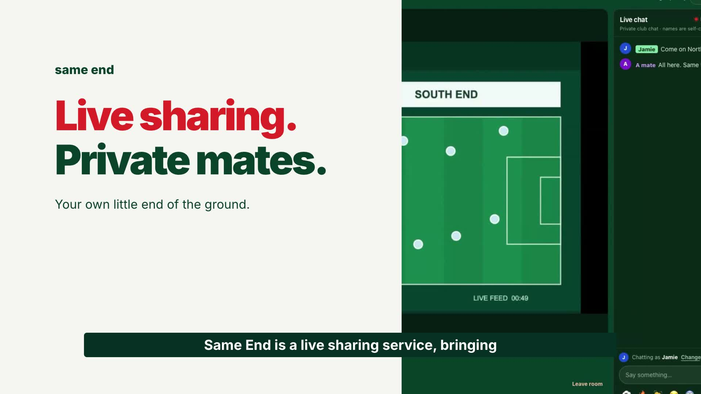
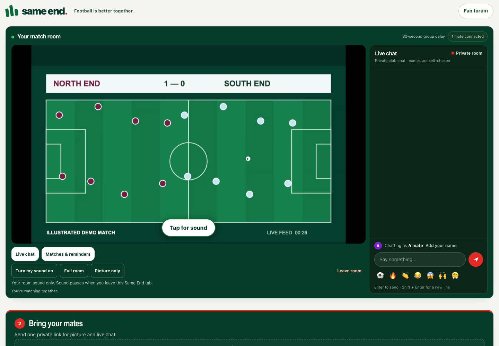
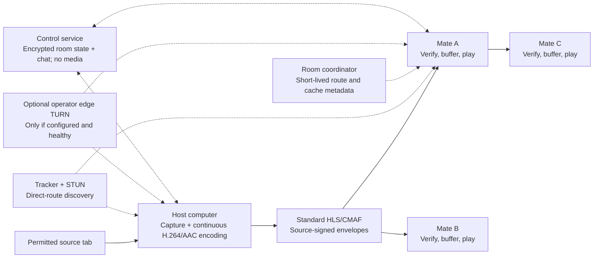

<h1 align="center">Same End</h1>

<p align="center"><strong>Your match. Your mates.</strong><br>A private place to watch together, chat and make match day a regular thing.</p>

<p align="center"><a href="https://www.sameend.com/watch.html">Try Same End</a> · <a href="https://www.youtube.com/watch?v=Ip8fAT8b8Go">Watch the 81-second film</a> · <a href="#how-it-works">How it works</a> · <a href="CONTRIBUTING.md">Contribute</a></p>

<p align="center"><a href="https://github.com/ezzye/same-end/actions/workflows/checks.yml"></a><br><a href="LICENSE">MIT licensed</a> · Early alpha · Peer-to-peer media by default</p>

Same End brings a small group of mates into the same private viewing room. One person shares a permitted browser tab from a computer; the others open an invitation to watch and chat. Save a club, plan the next match and add it to your calendar. Send the invitation in your existing WhatsApp group and keep your match-day circle together.

**The video travels between participants’ devices.** A separate service handles encrypted room state and chat. Private rooms need no account, extension or app installation; the optional public fan forum has its own account and pilot membership. Release builds use resilient version-3 media: independent audio and a 360p default, with optional 480p. The ordinary local build retains version-2 capture for compatibility checks.

## See it in action

[](https://www.youtube.com/watch?v=Ip8fAT8b8Go)

**[Play the latest 81-second film on YouTube](https://www.youtube.com/watch?v=Ip8fAT8b8Go)** · [Vimeo](https://vimeo.com/1239508557) · [The story behind Same End, with an embedded player](https://blog.sameend.com/why-same-end/)

The film shows the live app using an original illustrated match and synthetic narration. It demonstrates sharing, invitations, picture and chat; it does not establish audible source-tab capture, different-home connectivity or full-match reliability. The thumbnail opens the video; GitHub READMEs do not embed a YouTube player.

<details>
<summary>See the viewing room</summary>



Viewer page from the demo session; the match is an original illustration.

</details>

## Why Same End?

| For your mates | Under the hood |
| --- | --- |
| **One private invitation** for picture and chat | Saved room invitations can follow a restarted share |
| **Watch the same delayed programme** | A shared baseline gives peers time to receive and forward media |
| **A club beyond one match** | Saved club access, a match diary, calendar exports and optional reminders |
| **Join from a phone, tablet or computer** | Standard H.264/AAC with HLS playback; computers host |
| **Choose whether to help with analytics** | Explicit opt-in for three aggregate activity counters, with no visitor ID |

Same End is an early alpha for private, small-group use. Capture and direct connections depend on your device, network and source. Use material you are entitled to capture and share; an invitation grants no content rights, and Same End does not bypass DRM or service restrictions.

## Try a room

1. Open **[Same End](https://www.sameend.com/watch.html)** on a computer. Chrome or Edge is the preferred starting point for tab sharing with audio.
2. Choose **Share a tab**, select a permitted source and include tab audio when offered. Keep the source playing and the computer awake.
3. Choose **Invite your mates** and send the normal picture + chat invitation privately. Mates open it and turn their sound on when prompted.
4. Watch the **Same End player** together. The original source remains ahead of the group’s delayed picture.

You can invite mates and chat before sharing starts. For a regular group, choose **Create your club**, save its member invitation and plan a match. Keep the separate organiser link to yourself.

New shares can choose a **30–120-second common delay** from fresh delivery observations; insufficient evidence keeps the conservative **five-minute fallback**. A recovering viewer may stay up to 60 seconds further behind for smoother playback. Chat remains immediate, so exact frame alignment is not guaranteed.

[User guide](docs/user-guide.md) · [Device check](https://www.sameend.com/device-check.html) · [Rehearsal guide](test-guide.html) · [Troubleshooting](#when-something-doesnt-work)

## How it works

This diagram includes the resilience release. Both publishing workflows use `npm run build:resilience`; the ordinary local `npm run build` retains media version 2. `SAMEEND_RESILIENT_DELIVERY=1 npm run build` also enables version 3 for new shares. Updated clients, including the ordinary version 2 build, can still read version 1/2 invitations; older clients must refresh before opening a version 3 room.

Same End combines standard media formats with a custom live transport over WebRTC data channels. WebTorrent helps introduce peers; an ordinary torrent client cannot play this live transport. The resilience build adds a metadata-only room coordinator and an optional operator-run edge TURN fallback. The selected Mac edge host is supervised and assessed separately; only fresh admissible health enables credentials. The control cloud does not relay media.



1. **Capture and package.** A capable desktop browser captures the tab you select. Mediabunny continuously encodes H.264 video and AAC audio into standard HLS playlists and roughly two-second CMAF segments.
2. **Sign and distribute.** The source signs bounded envelopes containing the media. Direct WebRTC data channels carry them to viewers; authenticated peers can forward the original bytes. The browser transport caps a desktop source at two downstream viewers; the metadata coordinator gives each non-source peer at most one recommended child. The diagram illustrates a route, not certified group capacity.
3. **Verify and play.** Viewers verify signatures before adding media to bounded in-memory caches. hls.js reads the cache, or native Safari HLS uses a private service-worker bridge. The site server does not serve live video, and the app does not persist it to disk.
4. **Share a timeline and recover.** The host selects one common playback baseline. Peers can search for another supplier after a connection fails, preserving verified media and room context. A buffer cannot create future picture after the source disappears.
5. **Use a fallback only when available.** Direct peer routes remain the default. A separate operator-designated edge TURN server is an optional connectivity fallback; the coordinator returns short-lived credentials only while its signed capacity report is fresh and admits new sessions. TURN carries media only on that selected edge server. The app does not use a cloud media relay. No edge host has been chosen or deployed in this branch, and direct or TURN routing cannot promise seamless playback.

The room coordinator stores only short-lived metadata: participant route reports, reservations, and the media time ranges and renditions each peer says it has cached. Reports expire after 15 seconds. A recommendation is a hint, not proof of bandwidth: unknown outgoing capacity is labelled provisional and must not be read as a measured link. Authenticated direct peer links still establish the actual transfer.

Go deeper: [resilient delivery design and current status](docs/resilient-delivery.md), [illustrated network and playback guide](docs/network-and-playback.html), [HLS architecture](docs/standard-hls.md), [common-start policy](docs/measured-common-start.md), [delivery and recovery](docs/delivery-recovery.md), [direct-route limits](docs/direct-peer-discovery.md), [edge TURN preparation](docs/edge-turn.md).

### What runs where

| Component | Responsibility | Start reading |
| --- | --- | --- |
| Browser app / optional PWA | Room UI, capture, playback, clubs and chat | [app.html](app.html), [engine.js](engine.js), [social.js](social.js) |
| Media pipeline | Encoding, envelopes and cache-backed playback | [hls-capture.js](hls-capture.js), [hls-protocol.js](hls-protocol.js), [hls-player.js](hls-player.js) |
| Peer transport | Direct discovery, transfer and forwarding; optional edge TURN credentials | [magnet-transport.js](magnet-transport.js), [delivery-health.js](delivery-health.js) |
| Room coordinator | Expiring route reports, cache-range metadata and reservations; no media | [coordinator-client.js](coordinator-client.js), [backend/coordinator.mjs](backend/coordinator.mjs) |
| Control service | Club/chat storage, reminders, separate forum/feedback and staff tools | [backend/](backend/), [API contract](social-contract.md) |
| Static host | Built app, guides and public assets | [build-pwa.mjs](build-pwa.mjs), [Pages workflow](.github/workflows/pages.yml) |

### Privacy and trust

Room and club links are **bearer invitations**: anyone who receives one can forward it. Keep organiser access private. There is no per-person admission or revocation list. The service is not anonymous: introduction services and peers can see network metadata.

Club state and room chat are encrypted in the browser. Public forum posts and private support feedback have separate visibility rules. Analytics are off until you opt in; they count page loads, sharing starts and successful invitation copies, without a visitor ID or room/chat content. Functional storage and sign-in-provider cookies are separate.

Read the [privacy policy](PRIVACY.md), [analytics implementation](docs/privacy-analytics.md) and [security boundaries](docs/static-security.md).

## Run it locally

Use **Node.js 22+**, Git and npm for the full app/backend workflow. The frontend declares Node 20+; the backend requires 22+. CI uses Node 24.

```sh
git clone https://github.com/ezzye/same-end.git
cd same-end
npm ci
npm ci --prefix backend --ignore-scripts
SAME_END_LOCAL=1 npm run build
npm start
```

Open **http://localhost:8792/**. In a second terminal, from the repository root, start the local service for clubs and chat:

```sh
npm start --prefix backend
```

The frontend proxies `/api` to port 8795. Local data is in memory and resets when the backend stops; push is disabled without genuine settings. **`SAME_END_LOCAL=1` selects the local API** rather than the public service. Rebuild after source edits: `npm start` serves `dist/`.

For an isolated community/staff UI fixture, use `npm run review:community` and follow its terminal instructions. Its generated credential stays in ignored local files and has no production authority.

Localhost works on your computer only. Another device needs a suitable HTTPS deployment; a LAN IP is not a substitute for secure browser media APIs. The PWA can reopen its app shell offline; live rooms, chat and peers need connectivity.

### Checks

```sh
SAME_END_LOCAL=1 npm run build
npm test
```

Browser suites are opt-in and can need Playwright, installed Chrome, WebKit and, for capture checks, ffmpeg. See [the contributor test map](CONTRIBUTING.md#choose-the-checks-for-your-change) before starting longer suites.

## Help build Same End

You do not need to be a streaming expert. A clear bug report, accessibility improvement or carefully documented device test can be as useful as protocol work.

| You can help with… | Start here |
| --- | --- |
| Playback, sound and network observations | [Device check](https://www.sameend.com/device-check.html), [test reports](docs/test-observability.md) |
| Accessible, understandable match-day UI | [app.html](app.html), [brand.css](brand.css), [social.css](social.css) |
| Media continuity and browser compatibility | [HLS architecture](docs/standard-hls.md), [hls-player.js](hls-player.js) |
| Direct delivery and recovery | [Recovery design](docs/delivery-recovery.md), [engine.js](engine.js) |
| Privacy, consent and backend boundaries | [PRIVACY.md](PRIVACY.md), [analytics-core.js](analytics-core.js), [backend/](backend/) |
| Clear explanations and reproducible examples | [docs/](docs/), [this README](README.md) |

**First contribution:** [open an issue](https://github.com/ezzye/same-end/issues/new/choose) with a concrete problem, or fork the repository and open a focused pull request. Explain what changed, why it helps and what you actually checked. Keep credentials, invitations and personal reports out of public issues and commits.

Read **[CONTRIBUTING.md](CONTRIBUTING.md)** for setup, tests, bug reports and review guidance. If Same End interests you, a star helps others discover it.

## Development journey and next work

The idea started with a social question: if one mate is watching, how can the others feel like they are there too? Same End was developed iteratively with Codex, through generated-picture demos, browser capture, failed playback experiments and repeated repairs.

Early versions restarted small WebM/MP4 recordings and tried to join the clips. Decoder transitions, Apple playback, silent source audio, stalled suppliers and source restarts exposed different failure modes. The current path uses one continuous HLS/CMAF timeline, signed media, persistent room invitations, measured start and bounded recovery. [Why the media path changed](docs/standard-hls.md#what-changed).

| Implemented and covered by controlled checks | Stronger acceptance evidence still needed |
| --- | --- |
| Continuous HLS/CMAF over signed direct delivery | Physical-device playback and audible sound across OS/browser combinations |
| Saved invitations, encrypted room chat and club planning | Different-home and mobile-network reliability |
| Common start, adaptive buffering and supplier recovery | Long, real matches and recovery from real interruptions |
| Opt-in analytics and role-protected staff tools | Automatic switching between independent sources and make-before-break media handover are not implemented |

The release workflow selects version-3 media. Local qualification covers automatic audio downgrade/video return and an actual five-minute delayed P2P session while another viewer keeps decoding. The selected Mac's TURN software has passed external UDP/TLS and small bidirectional diagnostic relay checks. These are distinct from physical 5G, native Safari sound, long-match reliability and owner acceptance. The edge route is advertised only when fresh machine health and supervised router/certificate checks permit it; an unavailable edge does not add a cloud media relay. Updated clients read version 1/2, while older clients must refresh before reading version 3. Make-before-break handover is not implemented.

## When something doesn't work

| Symptom | First check |
| --- | --- |
| No picture, but chat works | A direct route may be blocked. Keep the page visible and open **Room settings & help → Your test report**. |
| Picture but no sound | Include tab audio, keep the source player unmuted, then choose **Turn my sound on** on the viewer. |
| Waiting before playback | Check the displayed group delay; five-minute warm-up is not itself a connection failure. |
| Pauses or growing delay | Keep devices awake; save a report with the browser, device and network scenario. |
| A mobile tab stops in the background | Return to it and keep it visible. PWA installation does not prevent OS suspension. |

Use **Send feedback** in the app for private support, or [open a public bug report](https://github.com/ezzye/same-end/issues/new/choose) with secrets removed. More: [source audio](docs/source-audio.md), [reconnection](docs/automatic-reconnection.md), [user guide](docs/user-guide.md).

## Licence and acknowledgements

Original code is [MIT licensed](LICENSE). Same End builds on WebTorrent (MIT), hls.js (Apache-2.0) and Mediabunny (MPL-2.0), plus the WebRTC, HLS and Web Crypto standards. See [THIRD_PARTY.md](THIRD_PARTY.md) for versions, source availability and notices, and [artwork/demo provenance](assets/README.md).
