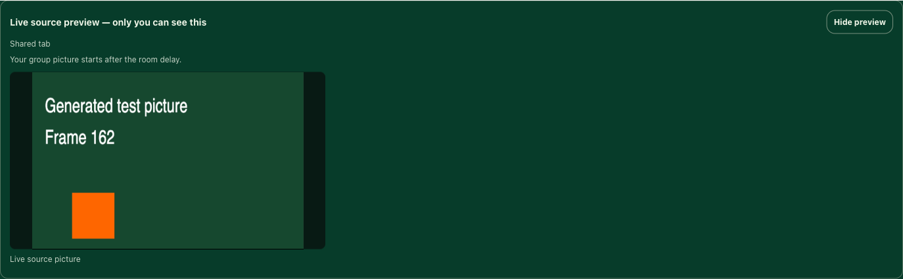
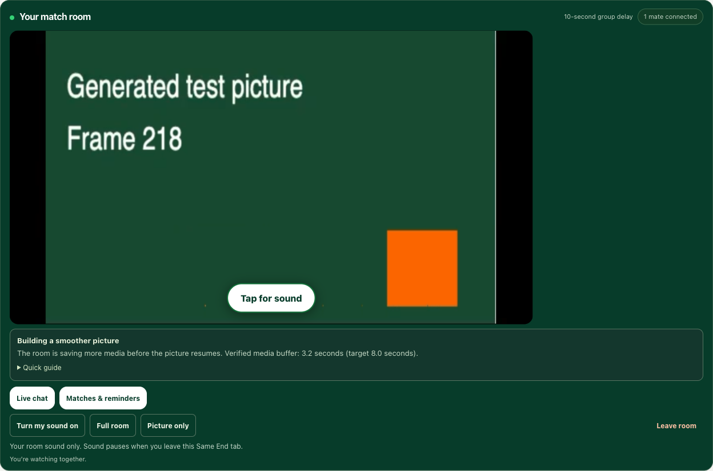

# Source sound warnings

The host gets a local check of the audio supplied to the recorder. A captured audio track is not treated as proof of audible content. After 15 seconds of continuously observed silence, the room shows a warning asking the host to check the original player's mute and volume. Normal quiet passages can also trigger it; the message says so. Sound returning clears the warning on the next sample.

Keep the original player unmuted. Chrome's `suppressLocalAudioPlayback` setting keeps the captured tab quiet locally without removing its audio from the stream. The room button is labelled **Mute my sound / Turn my sound on**: it affects that listener only. The existing page-visibility pause/resume behaviour is retained.

`source-audio.js` uses an audio-only view of the existing captured stream and a Web Audio analyser. It does not request a microphone, retain audio samples, upload levels, play the source through speakers, or modify/stop the captured tracks. The owned analyser/context are closed at room end. Only coarse local status is added to `PrivateCast.snapshot()`.

Missing audio, ended tracks, a suspended audio context, and unsupported measurement are separate states. A user gesture can enable a suspended check. Long timer gaps restart the silence window, so time spent without samples does not become a false warning. The warning describes captured input now; any correction reaches the delayed player after the configured group delay.

The byte-domain analyser supports older WebKit versions without `getFloatTimeDomainData`. See the [Web Audio specification](https://www.w3.org/TR/webaudio-1.0/#AnalyserNode) for analyser behaviour. It cannot identify which cross-origin source control was changed, guarantee downstream sound output, or work around protected-source restrictions.

Run `npm test` for the classifier/lifecycle checks. `npm run test:source-audio` uses a separate Chrome profile, an in-memory club API, a generated source tab and real `getDisplayMedia` tab capture. It verifies source mute → warning → unmute recovery, room-volume independence, and the existing hidden/visible event-handler behaviour. The automated capture window can stay visible while backgrounded, so that regression check simulates document visibility events; it is not new physical-device tab-switch acceptance. It requires a Chrome installation with screen-capture permission. No personal tabs or production clubs are used.

## Confirm the shared picture

A host now sees **Live source preview — only you can see this** above the group player. This is the browser-selected input picture, muted and without audio tracks. It confirms the selected tab/window/screen is producing a picture; it does not prove that peers have received it. The source hint uses only the browser-provided capture type and a conservative human-readable label when available. It omits URLs, filesystem paths and opaque capture identifiers. The hint stays on the host; it is not added to invitations, chat or telemetry. Hide preview collapses only this local picture.

The group player still follows its shared delay. Its scheduled start countdown remains visible while the group prepares. Once a decoded picture exists, waiting and recovery messages use a compact status below the picture instead of covering it. During recovery, verified media buffer and the actual playback target are shown when measured; these are media seconds, not a predicted download completion time. An unavailable measurement is not displayed as measured zero. A new cast resets the old picture confirmation.

Preview cleanup detaches its video without owning or stopping the shared tracks. Stopping a share, an ended track or failed startup clears the preview through the normal capture lifecycle. Existing room sound controls remain independent.

Run `npm run test:source-preview` after building. The isolated browser check captures generated moving content in Chrome, verifies a live muted host preview during a 300-second room wait, then checks an independent viewer after a short test delay. Recovery/remaining-time display states are exercised against the decoded test picture; these controlled states do not establish real-network recovery or TURN availability.

Generated-content browser checks (the recovery state is controlled for this UI check):

